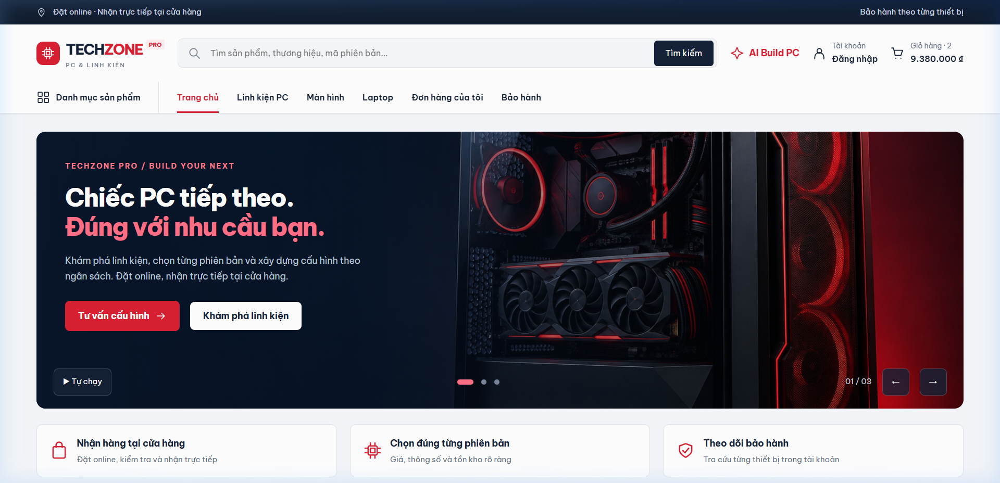
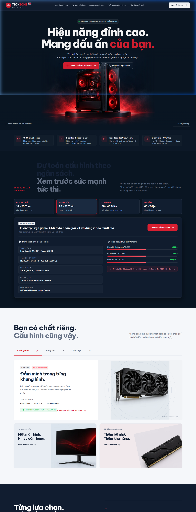
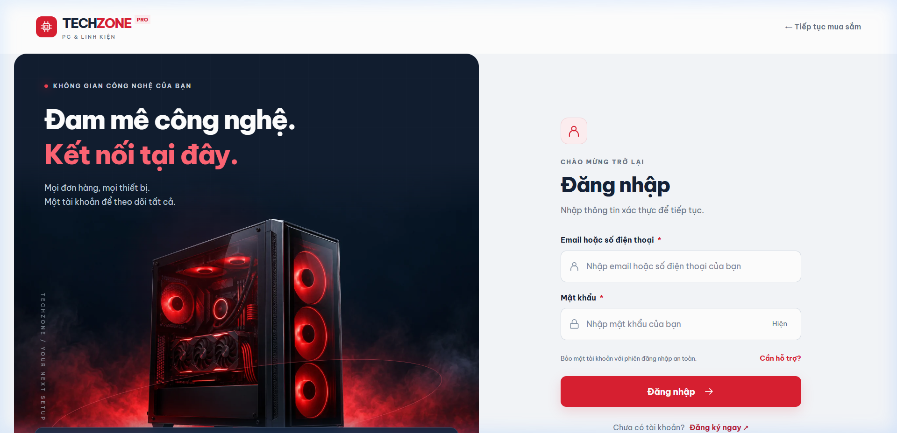
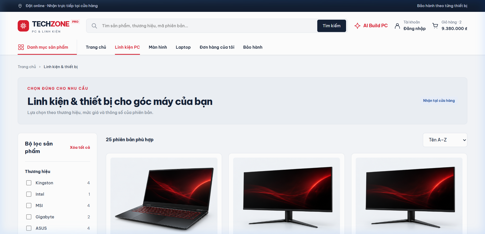
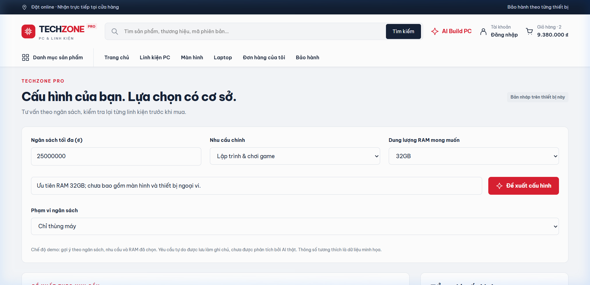

# TechZone Pro — PC & Components Storefront

> A full-featured React storefront for PC components, custom PC builds, orders, and warranty management. Built with **React 19**, **Vite**, **React Router 7**, and **Anime.js**.

> **API update:** Spring Boot now handles catalog/cart, store-pickup orders, cash collection, handover with per-device warranties, Admin promotions and post-purchase reviews. See [Pickup API integration](docs/PICKUP_API_INTEGRATION.md) for the complete flow, setup and current scope. Online payments/refunds still require a payment gateway. Set `VITE_USE_DEMO_DATA=true` for the original standalone demo.



---

## Table of Contents

- [Features](#features)
- [Screenshots](#screenshots)
- [Tech Stack](#tech-stack)
- [Prerequisites](#prerequisites)
- [Getting Started](#getting-started)
- [Project Structure](#project-structure)
- [Architecture](#architecture)
- [Available Scripts](#available-scripts)
- [Testing](#testing)
- [Environment Variables](#environment-variables)
- [API Integration](#api-integration)
- [Route Map](#route-map)
- [Documentation](#documentation)
- [Team Members](#team-members)
- [License](#license)

---

## Features

| Area | Description |
|------|-------------|
| **Product Catalog** | Browse PC components by category (monitors, laptops, RAM, etc.), filter, search, and view detailed specs with pricing |
| **AI PC Builder** | Select components with real-time compatibility checks (socket, RAM slots, power, M.2, form factor) |
| **Shopping Cart** | Add/remove items, quantity management, voucher validation with business rules |
| **Order Management** | Place orders, track status lifecycle, handover with serial numbers and payment verification |
| **Warranty System** | Per-device warranty cards, ticket creation (no duplicate open tickets), technician workflow |
| **Authentication** | Login/Register via backend API with JWT Bearer tokens and session management |
| **Role-Based Access** | Customer, Staff, Admin, Technician — each with dedicated dashboards and route guards |
| **Responsive UI** | Mobile-first design with Be Vietnam Pro font, smooth Anime.js animations |

---

## Screenshots

| Landing Page | Login Page |
|:---:|:---:|
|  |  |

| Product Catalog | PC Builder |
|:---:|:---:|
|  |  |

---

## Tech Stack

| Category | Technology |
|----------|------------|
| **Framework** | React 19.2 |
| **Build Tool** | Vite 8.3 |
| **Routing** | React Router 7 |
| **HTTP Client** | Axios 1.20 |
| **Animation** | Anime.js 4.5 |
| **Typography** | Be Vietnam Pro (Fontsource) |
| **Language** | TypeScript 7 + JavaScript (mixed) |
| **Linting** | ESLint 10 + custom architecture checker |
| **Formatting** | Prettier 3.9 |
| **Unit Testing** | Vitest 5 |
| **E2E Testing** | Playwright 1.63 (Chrome) |

---

## Prerequisites

- **Node.js** ≥ 18
- **npm** ≥ 9
- **Backend** (for auth): Spring Boot app running on `http://localhost:8080` (see [Backend Setup](#backend-setup))

---

## Getting Started

### 1. Clone the repository

```bash
git clone <repository-url>
cd frontend
```

### 2. Install dependencies

```bash
npm ci
```

### 3. Configure environment

```bash
cp .env.example .env.local
```

Edit `.env.local` if the backend runs on a different host/port:

```env
VITE_API_BASE_URL=http://localhost:8080
```

### 4. Start the development server

```bash
npm run dev
```

Open [http://localhost:5173](http://localhost:5173) in your browser.

> **Note:** API mode requires the backend for authentication and commerce flows. The standalone demo is opt-in through `VITE_USE_DEMO_DATA=true`.

### Backend Setup

The frontend connects to a **Spring Boot** backend for authentication (`/api/auth/login`, `/api/auth/register`).

1. Clone the backend repository
2. Configure the database (MySQL/PostgreSQL)
3. Run the Spring Boot application on port `8080`
4. The frontend will automatically connect via `VITE_API_BASE_URL`

> API mode does not write commerce data to `techzone-demo-v1`. Features without backend APIs display an unavailable state. The complete demo remains accessible in demo mode.

---

## Project Structure

```
frontend/
├── public/assets/              # Static images (preserved URLs)
├── docs/
│   ├── ARCHITECTURE.md         # Full architecture specification
│   ├── IMPLEMENTATION.md       # Screen map and behavior documentation
│   └── screenshots/            # README screenshots
├── scripts/
│   └── check-architecture.mjs  # AST-based architecture boundary linter
├── tests/
│   ├── domain.test.js          # Business logic unit tests (11 cases)
│   ├── api.test.js             # Axios integration tests (15 cases)
│   └── e2e/flows.spec.js       # Playwright E2E tests (11 flows)
├── src/
│   ├── assets/styles/          # Global CSS (global.css, landing.css, login.css, etc.)
│   ├── components/
│   │   ├── ui/                 # Shared UI: Button, Modal, Badge, Empty, ErrorBoundary
│   │   └── form/               # Form controls: Field, Select, Quantity
│   ├── features/               # ★ Feature modules (vertical slices)
│   │   ├── auth/               #   Login/Register — api, components, hooks, types
│   │   ├── products/           #   Product catalog — components, hooks, domain, constants, types
│   │   ├── cart/               #   Shopping cart — components, hooks
│   │   ├── orders/             #   Order management — components, hooks, domain, constants, types
│   │   ├── pc-builder/         #   AI PC Builder — api, components, hooks, domain, types
│   │   ├── promotions/         #   Voucher system — components, hooks, domain, types
│   │   ├── warranty/           #   Warranty tracking — components, hooks, domain, constants, types
│   │   ├── landing/            #   Landing page — components, hooks, constants
│   │   └── system-states/      #   Error/empty states — components
│   ├── hooks/                  # Shared hooks: useDebounce, useScroll
│   ├── layouts/                # Page shells: MainLayout, AuthLayout, AccountLayout, AdminLayout
│   ├── pages/                  # Thin page components (21 pages, composition only)
│   ├── routes/                 # AppRoutes, PrivateRoute, ScrollToTop, legacyAliases
│   ├── services/               # HTTP layer: axiosClient.ts, endpoints.ts
│   ├── store/                  # State management: StoreProvider, context, demo data
│   ├── types/                  # Shared types: ApiErrorResponse, pagination, common
│   ├── utils/                  # Shared utilities: formatters
│   ├── App.tsx                 # Root component (providers + router)
│   └── main.tsx                # Entry point (CSS imports + React DOM mount)
├── vite.config.ts
├── vitest.config.ts
├── tsconfig.json
├── playwright.config.js
└── package.json
```

---

## Architecture

The project follows a **Feature-Driven Architecture** (Vertical Slice), where each feature owns its own components, hooks, API calls, domain logic, and types.

### Core Principles

1. **Pages are composition-only** — Pages do not call HTTP, read global store, or compute business logic. They only glue features to layouts:

   ```tsx
   // src/pages/Product/ProductPage.tsx
   import { useCart } from "@/features/cart";
   import { ProductDetails } from "@/features/products";

   export default function ProductPage() {
     const { addToCart } = useCart();
     return <ProductDetails addCart={addToCart} />;
   }
   ```

2. **Features own their domain** — Each feature under `src/features/` contains:

   | Folder | Responsibility |
   |--------|---------------|
   | `components/` | JSX, CSS classes, UI callbacks |
   | `hooks/` | State management, filtering, form validation |
   | `domain/` | Pure business logic functions (testable with Vitest) |
   | `api/` | The **only** place allowed to import from `@/services` |
   | `types/` | Feature-specific TypeScript interfaces |

3. **Strict import boundaries** enforced by `scripts/check-architecture.mjs`:
   - Cross-feature imports must go through the feature's `index.ts` barrel
   - Shared UI imports must use `@/components/ui` or `@/components/form`
   - All imports use the `@/` alias (mapped to `src/`)
   - Features cannot depend on pages, layouts, or routes
   - Shared infrastructure cannot depend on features
   - Only `features/*/api/` files may import HTTP services

4. **Dependency flow**: `App → routes → pages/layouts → features → shared`

### Login Flow Example

```
LoginPage → useAuthForm → authApi → axiosClient → Backend API
          ↘ AuthLayout + LoginForm + AuthHelp (UI)
```

---

## Available Scripts

| Command | Description |
|---------|-------------|
| `npm run dev` | Start Vite dev server (default: port 5173) |
| `npm run build` | Type-check + production build |
| `npm run preview` | Preview the production build |
| `npm run lint` | ESLint + architecture boundary check |
| `npm run typecheck` | TypeScript type checking (both configs) |
| `npm test` | Run Vitest unit tests |
| `npm run test:e2e` | Run Playwright E2E tests (Chrome, port 4175) |
| `npm run format` | Format code with Prettier |
| `npm run check:architecture` | Run AST-based architecture linter only |

---

## Testing

### Unit Tests (Vitest)

- **Domain tests** (11 cases): pricing calculations, compatibility checks, voucher validation, stock management, serial verification, warranty lifecycle
- **API tests** (15 cases): JSON payloads, base URL, envelope/bare responses, token management, logout, custom headers, 204 handling, HTTP errors, validation errors, malformed JSON, network errors, request cancellation

```bash
npm test
```

### E2E Tests (Playwright)

- Renders 21 screens at 1440px and 390px viewports
- Full purchase flow through handover
- PC Builder compatibility workflow
- Admin operations
- Warranty management
- Role-based access control
- Category filtering
- Registration, login errors, and redirect
- Legacy URL redirects and 404 handling

```bash
npm run test:e2e
```

> E2E tests mock the auth API — no backend or database is required. The test server runs on port 4175 with in-process HTTP mocking for Windows compatibility.

### Architecture Verification

The custom `check-architecture.mjs` script uses **espree** (AST parser) to enforce:
- No unresolved imports
- No deep cross-feature imports (must use barrel `index.ts`)
- No import cycles
- No direct HTTP calls in pages
- No business logic in pages (no loops, try/catch, `useState`, `useEffect`, `filter`, `map`, etc.)
- Feature API boundary enforcement

```bash
npm run check:architecture
```

---

## Environment Variables

| Variable | Default | Description |
|----------|---------|-------------|
| `VITE_API_BASE_URL` | `http://localhost:8080` | Backend API base URL |
| `VITE_USE_DEMO_DATA` | `false` | Use `true` only for the standalone demo |

Create a `.env.local` file from `.env.example`:

```bash
cp .env.example .env.local
```

---

## API Integration

### Current Status

| Feature | Integration | Notes |
|---------|-------------|-------|
| **Auth (Login/Register)** | ✅ Real API | `/api/auth/login`, `/api/auth/register` |
| **AI Build PC** | ✅ Real API | `/api/pc-build/requirements/analyze`, `/api/pc-build/builds/{auto,validate,replacements,save}`; unavailable in demo mode |
| **Catalog, Cart, Checkout preview** | ✅ Real API | Products, authenticated cart, stock validation and voucher preview |
| **Order creation, payment, Warranty, Admin** | ⏳ Pending | Unavailable in API mode; original UI in demo mode |

### HTTP Client (Axios)

All HTTP communication goes through `src/services/axiosClient.ts`:
- **Base URL**: from `VITE_API_BASE_URL` env variable
- **Auth**: Bearer token read from `sessionStorage` on every request via request interceptor
- **Error handling**: Extracts `message` or `validationErrors` from backend response
- **204 responses**: Normalized to `null` data
- **No auto-retry**, no token refresh, no timeout, no auto-logout on 401

### Adding a New API

1. Create `features/<name>/api/<name>Api.ts`
2. Import `axiosClient` and `endpoints` from `@/services`
3. Add the endpoint to `src/services/endpoints.ts`
4. Define request/response types in `features/<name>/types/`
5. Call the API from the feature's hook, not from a page

---

## Route Map

| Area | Routes |
|------|--------|
| **Landing & Store** | `/`, `/cua-hang`, `/san-pham`, `/danh-muc/:category`, `/san-pham/:id` |
| **Build & Purchase** | `/build-pc`, `/gio-hang`, `/thanh-toan`, `/trang-thai` |
| **Customer** | `/dang-nhap`, `/dang-ky`, `/don-hang`, `/don-hang/:id`, `/bao-hanh`, `/tai-khoan` |
| **Operations** | `/van-hanh/don-hang`, `/van-hanh/ban-giao`, `/van-hanh/bao-hanh`, `/ky-thuat` |
| **Admin** | `/quan-tri/san-pham`, `/quan-tri/thong-so`, `/quan-tri/khuyen-mai` |

Legacy `.html` URLs are automatically redirected via `src/routes/legacyAliases.ts`.

---

## Documentation

- [ARCHITECTURE.md](docs/ARCHITECTURE.md) — Full architecture specification, import rules, and migration map
- [IMPLEMENTATION.md](docs/IMPLEMENTATION.md) — Screen map, preserved behaviors, and test verification results

---

## Team Members

<!-- Replace with your actual team information -->

| Name | Student ID | Role |
|------|-----------|------|
| [Name 1] | [MSSV] | [Role] |
| [Name 2] | [MSSV] | [Role] |
| [Name 3] | [MSSV] | [Role] |
| [Name 4] | [MSSV] | [Role] |
| [Name 5] | [MSSV] | [Role] |

---

## License

This project is developed as a coursework assignment and is not licensed for public distribution.
