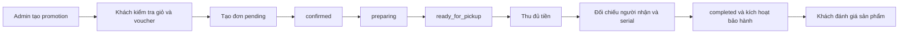

# Flow mua hàng, nhận tại cửa hàng, promotion và review

Chế độ mặc định dùng API Spring Boot. Backend sử dụng service interface trong `internal.service`, implementation trong `internal.service.impl`, controller trong `internal.controller` và DTO trong `api.dto.request`/`api.dto.response`.

## Luồng sử dụng

1. **Admin** vào `/quan-tri/khuyen-mai`: tạo/sửa mã giảm theo phần trăm hoặc số tiền, giới hạn lượt, thời gian và trạng thái. Banner có thể bật riêng khi đã nhập ảnh; banner hợp lệ xuất hiện ở trang chủ.
2. **Customer** xem sản phẩm tại `/san-pham`, chọn phiên bản/số lượng, thêm giỏ. Trong `/gio-hang`, kiểm tra tồn và tiếp tục `/thanh-toan`.
3. Nhập tên, số điện thoại nhận hàng và voucher. Chọn **Kiểm tra thông tin & voucher** hoặc **Áp dụng**, sau đó **Xác nhận đặt hàng**. Sửa dữ liệu sau preview yêu cầu kiểm tra lại.
4. Server kiểm tra lại giá/tồn/voucher, lưu snapshot sản phẩm và bảo hành, trừ tồn, giữ lượt voucher, tạo payment `PENDING`, xóa giỏ trong cùng transaction. Khách xem đơn tại `/don-hang`.
5. **Staff/Admin** vào `/van-hanh/don-hang`, chuyển lần lượt `pending → confirmed → preparing → ready_for_pickup`.
6. Nhân viên nhập số tiền thực nhận để xác nhận thu đủ. Payment chuyển `SUCCESS`; voucher chuyển từ `RESERVED` sang `USED`. Có thể ghi mã tham chiếu thu tiền.
7. Nhân viên tiếp tục bàn giao: nhập một serial cho mỗi thiết bị có bảo hành, đối chiếu số điện thoại người nhận và đánh dấu đã kiểm tra. Server chỉ hoàn tất khi đủ tiền, đúng người nhận và đủ serial duy nhất.
8. Bàn giao thành công chuyển đơn sang `completed`, tạo thẻ bảo hành cho từng thiết bị; thời hạn bắt đầu khi bàn giao. Khách xem tại `/bao-hanh`.
9. Khách mở đơn đã hoàn tất và đánh giá từng dòng hàng từ 1–5 sao; có thể sửa đánh giá. Đánh giá hiển thị ở trang sản phẩm tương ứng.



## Quy tắc nghiệp vụ

- Preview chỉ tính thử, không giữ tồn hay voucher. Khi đặt hàng, frontend gửi tổng/giảm giá đã preview để server phát hiện thay đổi; server tự tính lại và lấy dòng hàng từ giỏ của tài khoản.
- `Idempotency-Key` là UUID lưu theo tài khoản trong session trình duyệt. Nếu mất phản hồi, gửi lại cùng key trả về cùng đơn; không trừ tồn hai lần. Không xóa key khi lỗi mạng chưa rõ kết quả.
- Giá, tên phiên bản, số tiền giảm và số tháng bảo hành được lưu theo thời điểm đặt. Thay đổi catalogue/promotion sau đó không đổi giá trị đơn cũ.
- Voucher đang giữ cũng chiếm hạn mức. Hủy đơn hợp lệ hoàn tồn và trả lượt chung, nhưng tài khoản đã dùng mã đó không được dùng lại, kể cả đơn đã hủy, theo `UNIQUE(user_id, promotion_id)` trong SQL hiện tại.
- Customer được hủy ở `pending`/`confirmed`; Staff/Admin được hủy trước khi hoàn tất. Đơn đã thu tiền với số tiền dương cần quy trình hoàn tiền trước, nên hiện bị chặn hủy. Hủy lặp không hoàn tồn lần hai.
- Đơn có số tiền cuối bằng 0 được ghi nhận thanh toán thành công ngay; vẫn phải qua chuẩn bị và bàn giao.
- Chỉ chủ đơn được xem đơn/thẻ bảo hành hoặc gửi review. Staff/Admin xử lý đơn; chỉ Admin quản lý promotion. Role và trạng thái hoạt động được kiểm tra lại từ tài khoản backend.
- Mỗi dòng hàng có một đánh giá; sửa đánh giá cập nhật bản hiện có. Review chỉ mở sau `completed`.
- Thẻ sản phẩm và trang chi tiết hiển thị `averageRating`, `reviewCount`, `buyerCount` từ catalogue API. Điểm sao lấy trung bình các review thuộc đơn `completed`; người mua đếm tài khoản khác nhau có đơn `completed`, theo từng phiên bản. Một người mua nhiều lần hoặc mua nhiều thiết bị vẫn chỉ tính một người. Sản phẩm chưa có review hiển thị “Chưa có đánh giá”.
- Catalogue được tải lại khi chuyển đường dẫn trong ứng dụng hoặc quay lại tab trình duyệt, để thẻ sản phẩm không giữ thống kê cũ trong khi trang chi tiết đã tải review mới. Các phản hồi cũ và request đã hủy không ghi đè kết quả mới.
- Thời gian nghiệp vụ theo `Asia/Bangkok` (UTC+07:00), khớp trường `TIMESTAMP` trong SQL. Nhân viên đối chiếu trực tiếp số điện thoại, chưa có OTP nhận hàng.

## API

| Nhóm                  | API                                                                                                     |
| --------------------- | ------------------------------------------------------------------------------------------------------- |
| Catalogue             | `GET /api/products`                                                                                     |
| Giỏ                   | `GET /api/orders/cart`, `POST /api/orders/cart/items`, `PUT/DELETE /api/orders/cart/items/{cartItemId}` |
| Checkout              | `POST /api/checkout/validate`, `POST /api/checkout/details/preview`                                     |
| Tạo/xem đơn           | `POST /api/orders` (header `Idempotency-Key`), `GET /api/orders`, `GET /api/orders/{orderCode}`         |
| Khách hủy             | `POST /api/orders/{orderCode}/cancel`                                                                   |
| Vận hành              | `GET /api/operations/orders?search=&status=`                                                            |
| Trạng thái            | `PATCH /api/operations/orders/{orderCode}/status`                                                       |
| Thu tiền/bàn giao/hủy | `POST /api/operations/orders/{orderCode}/collect`, `/handover`, `/cancel`                               |
| Bảo hành              | `GET /api/me/warranties`                                                                                |
| Promotion             | `GET /api/promotions`; Admin: `GET/POST /api/admin/promotions`, `PUT /api/admin/promotions/{id}`        |
| Review                | `PUT /api/order-items/{id}/review`, `GET /api/products/{productVariantId}/reviews`                      |

Thêm giỏ dùng `productVariantId`; sửa/xóa giỏ dùng `cartItemId`; review và serial bàn giao dùng `orderItemId` do API đơn trả về.

## Chạy và thử bằng tài khoản thật

1. Chạy backend trong `D:\SBA_backend` với Java 21: `.\mvnw.cmd spring-boot:run`.
2. Trong frontend, đặt `.env.local` rồi chạy `npm run dev`:

```dotenv
VITE_API_BASE_URL=http://localhost:8080
VITE_USE_DEMO_DATA=false
```

3. Dùng ba tài khoản có role `Admin`, `Staff`, `Customer`, đăng xuất/đăng nhập luân phiên để đi theo các bước trên. Customer có thể tự đăng ký; tài khoản nhân viên/quản trị cần được cấp role trong dữ liệu hiện tại.

Catalogue cần `brands`, `categories`, `products`, `product_variants`, với `products.status = 'active'`. Menu có sẵn dùng slug `cpu`, `mainboard`, `ram`, `gpu`, `ssd`, `psu`, `case`, `cooler`, `monitor`, `laptop`. Thông số lấy từ `specification_values`, `specification_options` và `category_specifications`. Nếu chưa seed dữ liệu, trang hiển thị danh sách rỗng.

Backend dùng đúng bảng chữ thường trong `SBA301-scriptDB.sql`. Không tự tạo bảng tên chữ hoa hay di chuyển dữ liệu từ bảng cũ. Không chạy lại toàn bộ script SQL trên dữ liệu đang sử dụng vì script chứa lệnh xóa schema.

## Phạm vi hiện tại

Đã nối đầy đủ flow **thanh toán tại cửa hàng**. Thanh toán online và hoàn tiền chưa có tích hợp cổng thật; server từ chối phương thức chưa hỗ trợ. PC builder, quản trị sản phẩm/thông số, tiếp nhận sửa chữa bảo hành và màn hình kỹ thuật viên vẫn là phần riêng chưa nối trong chế độ API này. Hồ sơ hiển thị dữ liệu đăng nhập, chưa lưu thay đổi.

Bật `VITE_USE_DEMO_DATA=true` để chạy giao diện demo cũ. Chế độ API không ghi dữ liệu thương mại vào `techzone-demo-v1`.

## Kiểm thử

```powershell
npm test
npm run lint
npm run build
$env:PLAYWRIGHT_BROWSER_CHANNEL='msedge' # Nếu máy dùng Edge
npm run test:e2e
```

Playwright chạy demo (4175) và API (4176), gồm luồng Admin tạo promotion → Customer đặt hàng → Staff thu tiền/bàn giao → Customer xem hai thẻ bảo hành và review. HTTP được giả lập để kiểm tra UI và contract.

Backend `.\mvnw.cmd test` dùng H2 riêng, kiểm tra quyền, idempotency, giá thay đổi, số tiền thu, serial, review, hoàn tồn, hạn mức voucher và rollback transaction; có kiểm thử hai khách đồng thời mua tồn cuối/tranh lượt voucher cuối. Các kiểm thử này không kết nối hoặc sửa Neon. Cần kiểm tra thêm trên môi trường PostgreSQL thử nghiệm trước khi triển khai thực tế.
